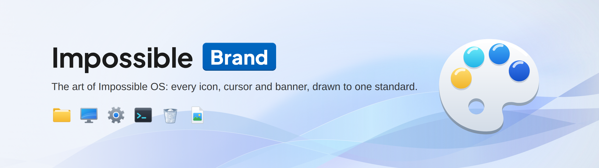

<picture>
  <source media="(prefers-color-scheme: dark)" srcset="identity/impossible-brand/banner-dark.png">
  <source media="(prefers-color-scheme: light)" srcset="identity/impossible-brand/banner-light.png">
  
</picture>

# Impossible Brand

The art of Impossible OS and its programs: colour icons, cursors, the logo and wordmarks, boot shortcuts, banners and wallpapers. Everything is drawn to one standard. The plan is a pinned pack that Impossible OS, Impossible SDK and every program repository import, so no program has to depend on the OS to look like it. Today the repository holds the art seeded from the OS; the pack, the engine and the imports follow the phases in the design below.

## What is here?

| Path | Holds |
| --- | --- |
| [`icons/src/`](icons/src/) | Colour icon sources, one SVG per icon on a 48 grid |
| [`icons/color/`](icons/color/) | The PNG renders at 16 to 256 pixels |
| [`cursors/`](cursors/) | The cursor set (Adwaita for now, see [CREDITS.md](CREDITS.md)) |
| [`identity/`](identity/) | The logo, wordmarks and their sources, logo PNGs, boot shortcuts and the desktop preview |
| [`wallpapers/`](wallpapers/) | Wallpapers and their SVG sources |
| [`identity/impossible-brand/`](identity/impossible-brand/) | This repository's own icon, banners and social preview; `python3 tools/identity.py` renders them |
| [`docs/icons.md`](docs/icons.md) | The art rules: grid, palette, light, small-size rules and the icon set |
| [`docs/specs/`](docs/specs/) | How the art left the OS, how consumers pin it and how a missing icon is drafted and designed |

## How does it relate to Impossible OS?

Impossible OS owns the interface: the icon and cursor names its code asks for, the SVG subset its renderer accepts, the theme tokens and the sizes. This repository owns the drawing: the sources, the tools that make and judge them, and the finished pack. Each pins the other by commit, and neither ever waits for the other. The design is [docs/specs/2026-11-25-brand-split-design.md](docs/specs/2026-11-25-brand-split-design.md).

The art was seeded from Impossible OS at commit `75c468c32`. Until the OS imports this pack, the OS's own copies stay authoritative for anything its run changes.

## Licence

GPL-3.0-only, like Impossible OS ([LICENSE](LICENSE)). Third-party art keeps its own licence, listed in [CREDITS.md](CREDITS.md).
